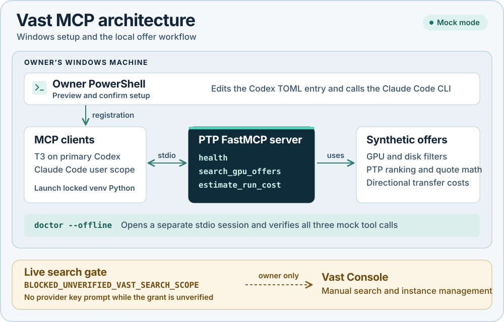

<p align="center">
  
</p>
<h1 align="center">Vast MCP</h1>
<p align="center">Shortlist GPU offers and estimate run costs from Codex or Claude Code.</p>
<p align="center">
  <a href="#quickstart">Quickstart</a> ·
  <a href="#example">Example</a> ·
  <a href="#tools">Tools</a> ·
  <a href="#architecture">Architecture</a> ·
  <a href="#troubleshooting">Troubleshooting</a>
</p>

Vast MCP is an independent, Windows-first MCP server that runs locally over stdio. Use it to try GPU search and cost estimates with synthetic data and without a Vast.ai account or API key.

> [!IMPORTANT]
> Live search is blocked while the Vast.ai search-only grant remains unverified. The wizard does not request a key. Use the Console or a separate owner terminal for live quotes, billing, rental, and SSH. [Vast Console](https://cloud.vast.ai/) · [Search-key policy](docs/VAST_SEARCH_KEY.md) · [Owner runbook](docs/OPERATIONS.md)

## Quickstart

### 1. Run the offline check

Use Windows PowerShell with Git, Python 3.12, and uv. Run the first two commands for a fresh checkout, or start at `uv sync` from an existing checkout. [Install uv](https://docs.astral.sh/uv/getting-started/installation/)

```powershell
git clone https://github.com/siriponsri/vast-mcp-test.git
Set-Location vast-mcp-test
uv sync --locked
uv run --locked vast-mcp doctor --offline
```

Look for `LOCAL_MOCK: PASS`. Doctor starts the local server and calls all three tools over stdio. Before registration, it reports the clients as `NOT_REGISTERED`.

### 2. Register with your MCP client

Put the Codex CLI, Claude Code CLI, or both on PATH. Use the owner's interactive PowerShell terminal. Run the preview first, then select **mock** and confirm the plan.

```powershell
uv run --locked vast-mcp setup --clients codex,claude --dry-run
uv run --locked vast-mcp setup --clients codex,claude
```

Use `--clients codex` or `--clients claude` to register just one client. Setup adds the `vast` entry to the primary Codex configuration or registers it at Claude Code user scope. Choose **skip** at the SSH prompt for a mock run.

After registration, rerun `uv run --locked vast-mcp doctor --offline` and look for a passing probe for each registered command. Open a new T3 session on the primary Codex account or a fresh Claude Code session to run the example. [Client verification guide](docs/T3_SETUP.md)

## Example

Paste this prompt into a client where `vast` is registered.

> Use the vast MCP server. Call `search_gpu_offers` with a limit of 3 and 40 GB of disk. Call `estimate_run_cost` for the first offer using the same disk allocation, 2 hours, 1 GB uploaded to the host, and 2 GB downloaded from the host.

The expected first offer is `mock-101` and the estimated total is **USD 0.588000**. Both results come from synthetic data. [Full smoke-test prompt](docs/T3_SMOKE_PROMPT.md)

## Tools

| Tool | What it returns |
| --- | --- |
| `health` | Server version, stdio transport, mock readiness, and live search status. |
| `search_gpu_offers` | A synthetic shortlist ranked by hourly price including allocated disk. Filter by GPU model, GPU count, VRAM per GPU in MiB, disk in GB, country, reliability, and maximum hourly price. |
| `estimate_run_cost` | Compute, allocated disk, upload, and download charges for an offer. Pass the same disk allocation as in the search and enter zero for any transfer direction you will skip. |

When a rate is missing for a planned transfer, the estimate reports the known subtotal and leaves the total unknown. For real rentals, use the provider quote. Planned hours do not cap spend or stop billing.

## Architecture



The server shares offer ranking and quote arithmetic with the PTP v0.1.1 planner. The CLI launch and registration approach draws on RunPod MCP. [Implementation details](docs/IMPLEMENTATION.md#architecture) · [RunPod MCP](https://github.com/runpod/runpod-mcp#run-locally-with-npx)

## Troubleshooting

| What you see | What to do |
| --- | --- |
| Doctor passes, but `vast` is missing from the client | Open a fresh session and confirm it uses the configured Codex account or Claude Code profile. |
| Doctor reports a missing or modified entry | Review the registration with the client guide. Setup refuses to replace an entry that differs from its saved receipt. |
| Setup was interrupted | Rerun setup or uninstall and confirm the offered rollback. |
| The checkout moved | Run `uv sync --locked` in the new location, then rerun setup and review the replacement path. |
| Live search is blocked | Use the Vast Console for real offers while `BLOCKED_UNVERIFIED_VAST_SEARCH_SCOPE` is active. |

For the SSH identity options and client profile details, see the [Windows setup notes](docs/WINDOWS_T3.md).

### Uninstall

Preview the removal, then confirm it from the owner terminal. The installer removes only registrations matching its saved receipt.

```powershell
uv run --locked vast-mcp uninstall --clients codex,claude --dry-run
uv run --locked vast-mcp uninstall --clients codex,claude
```

## Verification

Run `uv run --locked pytest -q` for the local test suite. The recorded Windows run passed 30 tests with native CLI integration enabled. Interactive T3 and Claude Code acceptance, live search, and paid operations have separate status entries. [Test results and reproduction steps](docs/QA.md)
