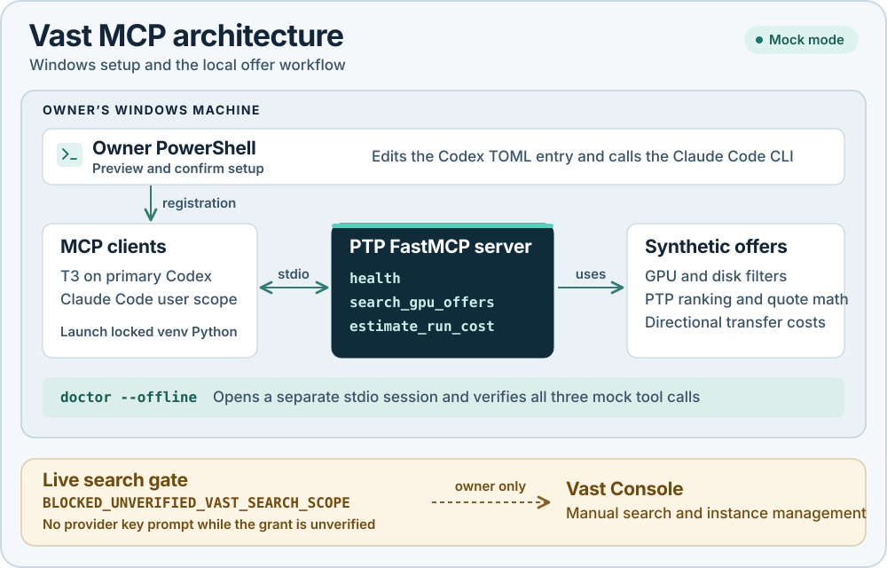

# Implementation and acceptance contract

## Delivered implementation

The PTP v0.1.1 package arrived as source during implementation. The original server module is the sole FastMCP implementation, shared by `vast-mcp serve` and the existing `ptp-vast-mcp` entry point. Search eligibility, ranking, and hourly quote arithmetic are shared with the PTP planner. The PTP provider adapter and owner lifecycle CLI remain separate from the MCP. The supplied source had no separate license file.

The mock backend provides fixture-only offers and has no provider transport. There is no verified exact provider grant, so selecting live search exits with `BLOCKED_UNVERIFIED_VAST_SEARCH_SCOPE` before any credential prompt. The provider and credential requirements below govern future live support.

Codex CLI add and remove were observed to normalize fields in unrelated MCP entries. The installer verifies CLI help and edits only the target Codex TOML table with a round-trip parser. Claude Code registration and removal use its user-scope CLI flags after verifying installed help. Configuration updates are tracked in `~/.vast-mcp/registrations.json` with a per-user installer lock and a pending rollback record. Close other config editors while confirming registration changes.

## Architecture

Solid arrows show local registration or runtime communication. The dashed arrow shows the owner's manual path to the Console when live search is blocked. The diagram represents the shipped mock path.

- Setup and client registration derive from the [CLI](../src/vast_mcp/cli.py) and [client adapters](../src/vast_mcp/clients.py).
- The single server, fixtures and quote math derive from the [PTP server](../ptp_vast_mcp/mcp_server.py), [synthetic offers](../src/vast_mcp/offers.py) and [shared planner logic](../ptp_vast_mcp/offer_math.py).
- The live gate and test coverage are documented in the [grant decision](VAST_SEARCH_KEY.md) and [verification receipt](QA.md).

The architecture diagram is editable SVG with an accessible title and description. The project uses an original PNG logo generated with the built-in image generation tool. [Logo asset](assets/logo.png)

Logo generation prompt

Design an original icon-only project logo for Vast MCP, an independent local developer tool for GPU offer comparison. Flat geometric mark: a compact angular V formed by two circuit traces with two square connector nodes, centered inside a solid deep navy rounded square. Use bright mint teal as the single mark color. Crisp hard edges, robust thick strokes, generous padding, instantly recognizable at 32 px. Transparent outside the rounded square. Center the icon in a square canvas, and make the icon occupy about 85% of the canvas width. No lettering, no existing corporate marks, no gradients, no shadows, no mockup.

## Objective

The Windows-first server runs in the owner's `siriponsri/vast-mcp-test` checkout. The supplied PTP source and tests are the baseline for shared quote logic and the separate owner-side tools.

Use `src/vast_mcp/`, `pyproject.toml`, a committed `uv.lock`, unit and integration tests, and English project docs. Separate provider HTTP, credential storage, client registration and cost estimation. The console entry point supports `setup`, `serve`, `doctor` and `uninstall`.

## Installer workflow

1. **Plan:** Show checkout, clients, account scope, server name, launch command and which registrations would change. `setup --dry-run` is credential-free and makes no changes or provider calls. Preserve unrelated settings; refuse unknown same-name entries or an unexpected `CODEX_HOME`. Repeat setup idempotently; ask before replacing an entry owned by the installer.
2. **Select mode:** Mock is the default; no credentials or HTTP are used. For a verified eligible live profile, prompt with no-echo `getpass` in the owner's interactive terminal; fail if no secure TTY exists. Use a tested OS credential store (Windows Credential Manager via a verified keyring backend), never a plaintext fallback. Pass only a profile identifier to agent configuration. No secrets in argv, JSON/TOML, repo, logs, stdio errors or child environment. A same-user agent with broad shell access is not isolated by keyring alone; never store a powerful lifecycle key for that agent. Provide credential rotation without rewriting agent config.
3. **SSH identity:** Offer existing local identity/path, generate a new personal identity, or skip. Generation should invoke local OpenSSH interactively, not overwrite a file and preferably use a passphrase/SSH agent. Keep private-key bytes out of MCP and repos. Only display the public-key registration path or fingerprint. Register `.pub` manually in Vast for v0.1. Do not disable host verification.
4. **Register:** Verify installed `--help`, preserve the primary Codex account and existing MCPs, and use an absolute locked-venv Python executable and argument list. Setup writes a Codex `mcp_servers.vast` entry and issues the following Claude Code command.
   - `claude mcp add --transport stdio --scope user vast -- <python> -I -m vast_mcp serve --profile <id>`
   - Detect partial installation, handle rollback or report exactly what remains; missing clients can be registered on a later rerun. Report T3 discovery separately after restarting the intended account/session. Claude Desktop is outside this release.
5. **Verify/undo:** `doctor --offline` uses an actual MCP client to run initialize, tools/list, health and a synthetic query; no paid resources or model calls. Only an explicit `doctor --live-search` can request live search and it is disabled for unverified profiles. `uninstall` removes only the registrations still owned by this installer. Removing the app-owned credential requires an explicit choice; never remove personal SSH files.

## Provider contract

- Use the exact fixed origin/path and request schema in the [Vast Search Offers API](https://docs.vast.ai/api-reference/search/search-offers). Its documented POST is semantically read-only. Do not expose generic HTTP, credentials management, SSH, remote command execution, or mutation endpoints. Use bounded inputs and results, verify TLS and disable redirects; no user-controlled host, headers or query-string auth. Redact provider errors and treat marketplace strings as untrusted input. Bound timeouts and retry only appropriate read-only transient failures, never create or destroy on error.
- Verify permission independently of search success. [Vast authentication](https://docs.vast.ai/api-reference/authentication#scoped-keys-and-permissions) notes console defaults to full access. Do not treat blanket `misc`, a disabled Billing write checkbox, a key label, an HTTP 200, or OpenAPI operation IDs as proof of a search-only grant. Do not test restrictions by attempting mutations. If exact provider-supported grant and its provisioning are not verified and documented, report `BLOCKED_UNVERIFIED_VAST_SEARCH_SCOPE`; keep mock plus Console usable. Do not prompt for or retain a broader key.
- Use a snapshot timestamp, stable offer ID, verified/rentable fields, GPU quantity and VRAM units, allocation size and unknown/missing price flags. Use the total hourly charge exactly once where it already includes allocated storage. Quote the same disk allocation as requested for rental. Add directional transfer charges separately; do not invent zero prices or claim to have found the global cheapest offer. Planned hours do not stop billing.
- Keep real rent, stop, destroy and SSH outside the MCP. If reusing a separate owner CLI, preserve its exact-offer re-quote, interactive approval, single create attempt, reconciliation after ambiguous results and verification after exact-ID destroy. Do not hand T3 its credential. If there is no genuine process/OS isolation from the agent, prefer Console for lifecycle actions. Test one explicitly approved instance only in a later live smoke; synthetic `nvidia-smi` only, no project data, secrets on the rented host, or agent forwarding.
- A future paid control plane may use a separate service identity, explicit human approval per lease, allowlisted capabilities, bounded spend/duration policy, reconciliation and an audit trail. It is not a v0.1 feature or a guarantee of cloud spend.

## Acceptance matrix

| Gate | Evidence |
| --- | --- |
| Locked build | Fresh trusted checkout, `uv sync --locked`, package version and clean/known Git state |
| Protocol | Real stdio initialization; stdout is protocol only. Verify expected tools, health, synthetic offer labels and deterministic cost outputs. |
| Security | Fake secrets never appear in config, process args, stdout/stderr, HTTP errors or fixtures. Reject unverified grant, non-TTY prompts, unsafe backends and unexpected endpoints. |
| Offline tests | Mock cannot call Vast; fixture coverage for malformed inputs, absent price, allocation agreement, double-counting, request timeout, and rate limits. |
| Setup/rollback | Fake CLI and temporary home tests for collisions, repeated installs, both clients, one missing client, partial registration/rollback, spaces and Thai paths, and removal preserving unrelated settings. |
| Client UAT | Report actual Windows Codex/T3 and Claude versions, tool discovery and mock call results separately. A fake client or written entry alone does not count. |
| Provider and billed smoke | Record LIVE_SEARCH and PAID_SMOKE separately as PASS / FAIL / BLOCKED / NOT_RUN. An optional future owner-approved paid test records exact offer, instance ID, observed GPU, confirmed final absence and actual known charges only. |

## Primary references

- [RunPod MCP](https://github.com/runpod/runpod-mcp), [Claude Code MCP](https://code.claude.com/docs/en/mcp), [Codex MCP](https://developers.openai.com/codex/mcp).
- [Vast permissions](https://docs.vast.ai/api-reference/permissions), [Vast Search Offers](https://docs.vast.ai/api-reference/search/search-offers), [Vast authentication](https://docs.vast.ai/api-reference/authentication).
- [Week 03 VastAi Skill](https://github.com/Tuchsanai/Teaching_CWN2026/blob/main/03_week03/01_VastAi_Skill/readme.md): use its offer-comparison exercise, not its shared SSH key, broad credentials, or prompt-only spending limit.
